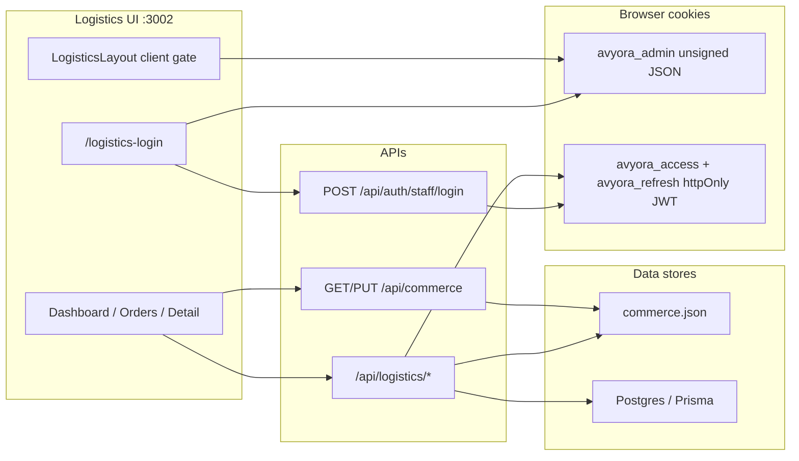
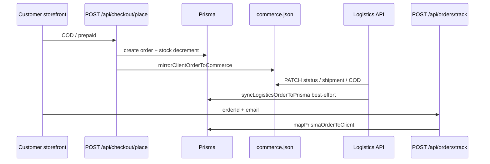

# Logistics Portal — Complete Audit

**Project:** Avyora jewellery e-commerce  
**Scope:** Logistics portal (`:3002`), logistics APIs, order/shipment lifecycle, COD, inventory touchpoints, security, testing, ops  
**Date:** 2026-09-09  
**Method:** Read-only codebase inspection (frontend, backend, Prisma, tests, Docker/CI). No production secrets inspected beyond presence of env templates.

---

## 1. Architecture

### 1.1 Frontend

| Piece | Location | Notes |
| --- | --- | --- |
| Host | Port `3002`, `AVYORA_APP=logistics` | `next.config.ts` → `.next-logistics` |
| Routes | `/logistics`, `/logistics/orders`, `/logistics/orders/[id]`, `/logistics-login` | App Router client pages |
| Layout gate | `src/components/logistics/logistics-layout.tsx` | **Client-only** — checks Zustand user + `ops.adminUsers.permissions` |
| Data load | `fetchLogisticsOrders` / `fetchLogisticsOrder` + Zustand `mergeOrders` | Also polls `/api/commerce` every 4s via `providers.tsx` |
| Shared UI | `OrderTrackingTimeline` | Storefront + logistics |

### 1.2 Backend

| Piece | Location | Notes |
| --- | --- | --- |
| Logistics APIs | `src/app/api/logistics/**` | JWT via `avyora_access` only |
| Mutations | `src/server/logistics/mutations.ts` | Status / shipment / COD / attempts / tracking |
| State machine | `src/lib/logistics-orders.ts` → `canTransitionOrderStatus` | Enforced on write path |
| Persistence | **Primary:** `data/commerce.json` | Secondary: best-effort Prisma sync |
| Admin guard | `src/server/commerce-order-guard.ts` | Admin PUT cannot overwrite logistics-owned fields |

### 1.3 Database (Prisma)

Relevant models: `Order`, `OrderItem`, `OrderStatusHistory`, `Shipment`, `Payment`, `Return` (shell), `Refund`, `Inventory`, `StockMovement`, `AdminUser` / `Role` / `Permission`.

**Not in Prisma:** `DeliveryAttempt` (JSON-only on commerce `Order`), rich tracking events, POD, parcel weight/dims on operational shipment path.

### 1.4 Authentication architecture

**Critical split:** UI trusts `avyora_admin` + local `staffLogin` (hardcoded `avyora123` on fallback). APIs require JWT. Middleware only does host/path redirects — **no session gate**.

### 1.5 Logistics workflow (as implemented)

Happy path (strict +1 step):

`Pending Payment → Confirmed → Processing → Packed → Ready to Ship → Shipped → In Transit → Out for Delivery → Delivered`

Also: Cancelled, Failed Delivery ↔ Out for Delivery, RTO, Return Requested → Return Pickup → Returned, Refunded (from eligible statuses).

### 1.6 Communication with e-commerce

### 1.7 External integrations

| Integration | Status |
| --- | --- |
| Razorpay | Checkout/verify/webhook (prepaid); not logistics-owned |
| SMTP | Order notify API; **not** called from logistics PATCH |
| Courier | Stub provider; admin shipment create accepts weight but stub only |
| WhatsApp / push | Console/stub providers |
| Meilisearch | Optional search; unused by logistics |

### 1.8 Important dependencies

Next.js 16, React 19, Prisma 6, Zod, Zustand, Jose (JWT), Playwright, Vitest, Docker Compose (docs; Docker may be absent on host).

---

## 2. Feature Inventory

| Feature | Exists | Working | Backend Protected | Database Connected | Needs Improvement |
| --- | --- | --- | --- | --- | --- |
| Host isolation (:3002) | Yes | Yes | N/A | N/A | Edge auth missing |
| Staff logistics login | Yes | Partial | Staff API | Prisma users | Dual cookie/JWT; hardcoded fallback |
| RBAC (view/manage) | Partial | Partial | JWT ORDER_* | Prisma permissions | UI uses `"orders"`/`"shipping"` strings |
| Dashboard KPIs | Yes | Partial | No | commerce poll | No dedicated API; missing COD/RTO ops KPIs |
| Order list search | Yes | Partial | View JWT | commerce.json | Client-only; caps at 100 orders |
| Filters (status/payment/partner/date/delayed) | Yes | Partial | API supports | commerce.json | UI does not pass server query params |
| Pagination | Yes | Partial | API pageSize≤100 | commerce.json | Client pagination over first page only |
| Bulk status / partner | Yes | If JWT | Manage JWT | JSON + Prisma sync | Status not Zod-enum |
| Shipment fields (id/tracking/partner/ETA) | Yes | If JWT | Manage JWT | JSON + partial Prisma | No weight/dims/POD/AWB UI |
| Status transitions | Yes | Yes | Server `canTransition` | N/A | Cannot skip stages; Prisma enum gaps |
| Tracking timeline | Yes | Yes | Manage for writes | JSON events | Custom events not fully in Prisma |
| Delivery attempts | Yes | If JWT | Manage JWT | JSON only | Not in Prisma; lost on /track |
| COD collect | Yes | Broken vs place | Manage JWT | JSON + Prisma | Place sets SUCCESS early |
| Returns / RTO statuses | Yes | Partial | Manage JWT | JSON; Prisma sync fails | No inventory restore |
| Notifications on advance | Partial | Weak | Notify API auth | SMTP | Logistics API does not notify |
| Inventory awareness | Hint only | Local catalog | No | Not live Inventory API | Double stock surfaces |
| Partner performance cards | Yes | Partial | No | ops.deliveryPartners | No persisted partner metrics |
| Pickup management | No | — | — | — | Missing |
| POD (OTP/photo/signature) | No | — | — | — | Missing |
| Partial shipment | No | — | — | — | Missing |
| Audit trail (who/why) | Partial | lastUpdatedBy | Soft | JSON + statusHistory | Incomplete for attempts/COD |
| E2E critical path | Yes | Yes | — | Prisma+JSON | Narrow (to Packed only) |
| Unit tests (transitions/COD guard) | Partial | Yes | — | — | Thin coverage |
| Docker / health / metrics | Yes | Unverified locally | Metrics open | Dual counts | Metrics unauthenticated |

---

## 3. API Audit

### `GET /api/logistics/orders`

| Field | Detail |
| --- | --- |
| Purpose | List/filter/paginate logistics orders |
| Auth | `canViewLogistics` → 401/403 |
| Validation | Query string filters; `pageSize` 1–100 |
| DB | `loadCommerce()` |
| Risks | Full PII to any view role; client ignores most filters |
| Perf | Loads all orders into memory then filters |

### `PATCH /api/logistics/orders` (bulk)

| Field | Detail |
| --- | --- |
| Purpose | Bulk status or partner assign |
| Auth | `canManageLogistics` |
| Validation | Zod `ids` + action; **status is free string** |
| DB | commerce + `syncLogisticsOrderToPrisma` |
| Risks | Mass update without idempotency keys; weak status schema |

### `GET /api/logistics/orders/[id]`

| Field | Detail |
| --- | --- |
| Purpose | Single order |
| Auth | View |
| IDOR | Order IDs are opaque numbers; any authorized logistics user can read any order (acceptable for shared ops; no per-courier scope) |

### `PATCH /api/logistics/orders/[id]`

| Field | Detail |
| --- | --- |
| Purpose | Status, shipment, COD |
| Auth | Manage |
| Validation | Zod optional fields; status transition enforced in mutations |
| Security | Good transition checks; COD method check |

### `POST .../attempts`

| Field | Detail |
| --- | --- |
| Purpose | Record delivery attempt; optional Failed Delivery |
| Auth | Manage |
| DB | commerce only (attempts array) |

### `POST .../tracking`

| Field | Detail |
| --- | --- |
| Purpose | Append free-form tracking event |
| Auth | Manage |
| DB | commerce; Prisma gets weak note on status sync only |

### Related non-logistics endpoints

| Endpoint | Relevance |
| --- | --- |
| `POST /api/checkout/place` | Mirrors to commerce; COD SUCCESS bug |
| `POST /api/orders/track` | Prisma-only customer track |
| `PUT /api/commerce` | Admin sync; logistics fields preserved |
| `POST /api/orders/notify` | Email; not auto-called by logistics |

---

## 4. Database Audit

### Strengths

- Order / payment / shipment / status history models exist
- Indexes on `orders(status, createdAt)`, `shipments(orderId)`
- Checkout and cancel use transactions for stock movements (place/cancel paths)

### Gaps

| Issue | Impact |
| --- | --- |
| Prisma `OrderStatus` missing Failed Delivery, RTO, Return Pickup, In Transit | Sync no-ops → customer track lag |
| No `DeliveryAttempt` table | Attempts JSON-only |
| `Return` model unused by logistics/admin flows | No QC/restock linkage |
| `Inventory.reserved` unused | No reservation lifecycle |
| Shipment missing operational weight/dims/POD/pickup timestamps | Incomplete shipment record |
| Dual write JSON + Prisma | Divergence under sync failure |

### Recommended schema (justified)

1. Extend Prisma enum (or mapping) for exception statuses used in UI.  
2. Add `DeliveryAttempt` (or JSON column on Order) if track must show attempts.  
3. Extend `Shipment` with weight/POD/pickup only when product needs them.  
4. Defer full reservation system until single stock source of truth.

---

## 5. Business Workflow Audit

| Flow | Status |
| --- | --- |
| Place → Confirm → Pack → Ship → OFD → Delivered | Supported (+1 step) |
| Cancel before delivered | Supported |
| Return after delivered | Status-only; no restock/refund automation from logistics |
| Failed delivery → retry / RTO | Status machine yes; Prisma sync no; no inventory |
| Invalid Delivered → Packed | **Blocked** by state machine ✓ |
| Partial shipment / partial cancel | **Not implemented** |
| Pickup scheduled / picked up as first-class | Collapsed into Ready to Ship / Shipped language |

---

## 6. Security Summary

| Finding | Severity |
| --- | --- |
| Unsigned `avyora_admin` cookie unlocks UI | Critical |
| Hardcoded `avyora123` staff fallback | Critical |
| JWT secret defaults to `dev-only-change-me` | Critical (if env missing) |
| No middleware JWT on `/logistics/**` | High |
| Permission vocabulary mismatch UI vs API | High |
| Logistics PATCH does not notify (ops gap more than vuln) | Medium |
| `/api/metrics` unauthenticated | Medium |
| Bulk status not enum-validated | Medium |

---

## 7. Performance Summary

- List API loads full commerce orders array (fine at small scale; not scalable).  
- Dashboard recomputes KPIs client-side from Zustand.  
- 4s commerce polling on all portals.  
- No N+1 Prisma on logistics path (JSON primary).  
- Caching not recommended until Prisma becomes SoT.

---

## 8. Testing Summary

| Layer | Coverage |
| --- | --- |
| Unit | Commerce order guard + COD collect helpers |
| E2E | Checkout → logistics Packed → track |
| Missing | Auth bypass, RTO, returns restock, COD Pending, attempts, bulk, unauthorized manage |

---

## 9. Observability

- Structured JSON logger exists.  
- `lastUpdatedBy` / status history notes on sync.  
- No dedicated audit log table for logistics actions.  
- Health + metrics endpoints present.

---

## 10. Overall assessment

The logistics portal is a **functional ops MVP**: real APIs, real transition rules, admin field protection, COD collect endpoint, Playwright path through Packed. It is **not production-ready** due to auth UI/API split, COD money-state bug, dual SoT, missing Prisma sync for exception statuses, no return inventory, and thin notifications/tests.

**Estimated logistics completeness (pre-improvement):** ~4.5 / 10.
